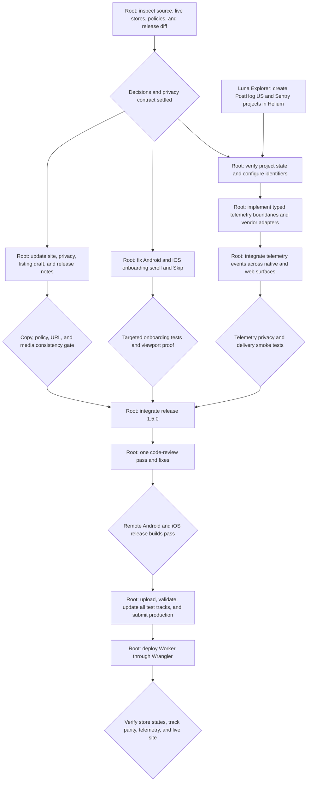

# Super Alarm telemetry, onboarding, and 1.5.0 release spec

## Background

Super Alarm is a native Kotlin/Jetpack Compose Android app, a native Swift/SwiftUI iOS app, and a Cloudflare Worker marketing and legal site. Android production currently serves 1.4.1 (version code 12), while its alpha, beta, and internal tracks serve 1.4.0 (version code 11). The App Store currently serves iOS 1.4.0 (build 11). The site still presents iOS as a TestFlight beta even though the App Store release is live.

The product has local diagnostics but no remote product analytics or crash reporter. Its privacy policy and store copy explicitly claim that no analytics, tracking libraries, or crash reporters exist. Android onboarding can trap users on the phone-setup page because the oversized content does not scroll reliably on short OEM viewports. The iOS onboarding page has no scroll container, so it has the same structural defect on small screens and with large Dynamic Type.

The desired state is a privacy-safe, observable 1.5.0 release. PostHog Cloud US measures anonymous product use across the native apps and marketing site. Sentry reports native crashes, handled operational errors, performance failures, and Worker failures. Onboarding always scrolls, can be skipped from any step, and can be reopened later. Public copy and store metadata describe the current object-detection flow and link to both production stores. Android production and every existing testing track receive the same release, iOS receives the release through App Review and all applicable TestFlight groups, and the site is deployed only after its production links and disclosures are correct.

## Settled decisions

- Use PostHog Cloud US and Sentry Cloud on their free plans unless observed volume requires a later plan decision.
- Release Android directly to 100% of production users with no staged rollout. Update the existing `alpha`, `beta`, and `internal` tracks to the same version code in the same coherent release.
- Submit iOS directly for App Review with automatic release at approval. Publish the same build to existing internal and external TestFlight groups where available.
- Add **Skip** to every onboarding step on Android and iOS. Skipping persists onboarding completion, opens the main alarm surface, and does not silently grant permissions or create dismissal targets.
- Keep onboarding recoverable from the existing Health or Settings surface with a **Run setup again** action.
- Refresh real store screenshots only when the live media does not show the shipped object-detection flow. Never create mock product states.
- Ship the native apps as version 1.5.0. Use Android version code 13 and iOS build 12 unless a failed or cancelled store upload consumes either number before the final archive is produced.

## Done

### Product telemetry

- A single canonical event catalog exists in source and documentation. Android, iOS, and web use the same event names and property meanings.
- PostHog receives deliberate screen, lifecycle, funnel, alarm-reliability, dismissal, permission, widget, diagnostics, and store-link events from release builds. PostHog may process the client IP to derive coarse location because Hasan explicitly enabled that project setting.
- Events are anonymous. The apps do not call `identify`, create person profiles, send email addresses, or send alarm labels, object labels, QR payloads, images, feature prints, diagnostics exports, notification text, file paths, or free-form user input.
- Session replay, touch autocapture, automatic exception capture in PostHog, and automatic native screen capture are off. Application lifecycle capture may remain on when its payload passes the privacy boundary.
- Both apps expose **Share anonymous analytics** in Health or Settings. It is on by default, clearly described, persists locally, and immediately calls the SDK opt-out or opt-in path when changed.
- PostHog dashboards cover activation, onboarding completion, permission readiness, alarm delivery, dismissal outcomes, retention, and marketing-to-store conversion.

### Errors and performance

- Sentry has separate Android, iOS, and Cloudflare Worker projects under the Q9 Labs organization.
- Android reports crashes, ANRs, handled operational failures, app-start performance, slow UI work, and tagged release/environment data. Release builds upload mapping files.
- iOS reports crashes, hangs, handled operational failures, launch and interaction performance, and tagged release/environment data. Release builds upload dSYMs.
- The Worker reports unhandled request failures with route and release context.
- `sendDefaultPii` is false. A `beforeSend` boundary removes denylisted keys and drops payloads that contain product-private content.
- Expected user choices such as denied permissions, cancelled sheets, invalid scans, and offline queues are product events or local states, not Sentry errors.
- Sentry alerts exist for a new regression, a crash-free-session drop, an ANR or hang regression, and a Worker error spike.

### Onboarding

- Every onboarding page scrolls on the screenshot’s short Android viewport, the smallest supported iPhone viewport, landscape where supported, and large accessibility text.
- Primary actions remain reachable without relying on clipped content or a fixed-height weighted spacer.
- **Skip** is visible and accessible from every step. It opens a confirmation sheet that explains that alarm-critical permissions and a dismissal target may still need setup.
- Confirming Skip records `onboarding_skipped` with only the current step and platform, completes onboarding, and opens the main screen.
- Cancelling Skip leaves onboarding unchanged.
- **Run setup again** resets only onboarding progress. It does not delete alarms, dismissal targets, or permission state.
- Android and iOS have targeted tests for completing, skipping, cancelling Skip, reopening setup, and preserving user data.

### Marketing, privacy, and stores

- The marketing site links Android to `https://play.google.com/store/apps/details?id=com.superalarm.app` and iOS to `https://apps.apple.com/app/id6770966337`. No public page calls the App Store build a TestFlight beta.
- The first viewport says what Super Alarm does, names object or QR dismissal, and provides both official store actions.
- Site and store copy describe on-device object recognition accurately and avoid guarantees that the alarm cannot miss.
- The privacy policy names PostHog US and Sentry, the categories they receive, their purposes, retention or control paths, and the in-app analytics opt-out. It preserves the separate statement that camera frames, visual fingerprints, QR payloads, labels, and alarm configuration stay on device unless the user exports diagnostics.
- Google Play Data Safety and Apple App Privacy answers match the compiled SDKs and observed network traffic before submission.
- Store release notes describe telemetry controls, onboarding scrolling and Skip, and the current object-detection flow.
- Any refreshed screenshots come from the final 1.5.0 build and pass platform dimension checks.
- The deployed Worker returns HTTP 200 for `/`, `/privacy`, and `/support`; its public metadata, canonical tags, store links, and telemetry requests are verified from the live URL.

### Release

- The Android AAB and iOS IPA are built and signed on `agents-macmini` from the same reviewed source revision.
- Artifact inspection confirms bundle/package ID `com.superalarm.app`, version 1.5.0, Android version code 13 or later, iOS build 12 or later, intended permissions, telemetry SDKs, mapping files, dSYMs, and no unexpected SDK or permission.
- Targeted tests, both platform builds, telemetry smoke tests, onboarding viewport tests, and one code-review pass are green before any store commit.
- The Android edit validates before commit. Production, alpha, beta, and internal point at the same new version code after the commit.
- The iOS version validates before submission. The build finishes processing, goes to applicable TestFlight groups, and is submitted for App Review with automatic public release.
- The release remains open until Google Play shows the production change published at 100%, every existing test track shows parity, App Store Connect shows the submitted version’s real state, and the Worker’s live revision is verified. Review time is an external gate, not permission to claim that iOS is live early.

## Canonical telemetry language

- **Surface**: a user-visible screen, tab, dialog, notification entry, widget, or marketing route.
- **Action**: a deliberate user or system transition that changes product state or advances a funnel.
- **Outcome**: the success, failure, cancellation, timeout, or permission result of an action.
- **Alarm delivery**: the chain from a stored enabled alarm through scheduling, firing, ringing, and dismissal or miss.
- **Dismissal target**: either an enrolled object or a QR spot. Telemetry records only `object` or `qr`, never its label or payload.
- **Operational failure**: an unexpected failure that prevents the requested product behavior and belongs in Sentry.
- **Expected outcome**: a normal product branch such as permission denial or scan mismatch; it belongs in PostHog, not Sentry.

## Event catalog

Every event includes `platform`, `app_version`, `build_number`, `environment`, and a non-identifying `source` when useful. Durations and lateness use bounded numeric values or buckets. Counts must be capped before transmission.

| Area | Events | Allowed properties |
| --- | --- | --- |
| Lifecycle and navigation | `app_opened`, `app_backgrounded`, `surface_viewed` | `surface`, `launch_source`, `is_first_launch` |
| Onboarding | `onboarding_started`, `onboarding_step_viewed`, `onboarding_step_completed`, `onboarding_skip_opened`, `onboarding_skip_cancelled`, `onboarding_skipped`, `onboarding_completed`, `onboarding_restarted` | `step`, `completion_path`, readiness booleans |
| Permissions | `permission_action_selected`, `permission_result_observed`, `device_settings_opened` | `permission_kind`, `result`, `manufacturer_family` only when needed for OEM reliability |
| Dismissal setup | `dismissal_enrollment_started`, `dismissal_enrollment_completed`, `dismissal_enrollment_cancelled`, `dismissal_enrollment_failed`, `dismissal_target_deleted` | `target_type`, duration, bounded capture or attempt count, failure code |
| Alarm setup | `alarm_time_changed`, `alarm_repeat_changed`, `alarm_enabled`, `alarm_disabled`, `alarm_scheduled`, `alarm_schedule_failed` | repeat-day count, time-of-day bucket, `target_type`, `source`, failure code |
| Delivery | `alarm_fired`, `ringing_started`, `backup_ring_fired`, `dismissal_started`, `dismissal_attempted`, `alarm_dismissed`, `alarm_missed`, `ringing_stopped_unexpectedly` | scheduled-lateness bucket, `target_type`, bounded attempts, duration, system reason code |
| Reliability test | `wake_up_test_scheduled`, `wake_up_test_started`, `wake_up_test_passed`, `wake_up_test_failed`, `wake_up_test_cancelled` | readiness booleans, duration, failure code |
| Health and support | `health_check_viewed`, `diagnostics_exported`, `analytics_preference_changed`, `support_action_selected` | readiness summary, export success, analytics enabled, channel |
| Widget | `widget_viewed`, `widget_action_selected`, `widget_action_completed`, `widget_action_failed` | widget family or size, action, duration preset, failure code |
| Marketing | `marketing_page_viewed`, `store_link_clicked`, `support_email_clicked` | route, platform target, placement, referrer host without query data |

`surface` values are finite enums owned by each platform adapter and mapped to shared names. Failure codes are finite domain enums. Do not send exception messages or arbitrary strings to PostHog.

## Dashboards and alerting

1. The activation funnel measures `app_opened` on first launch, target enrollment, an enabled alarm, permission readiness, a passed wake-up test, and onboarding completion or Skip.
2. The alarm-delivery funnel measures scheduled, fired, ringing, dismissal started, and dismissed. It segments by platform, release, dismissal type, and readiness state.
3. The dismissal dashboard measures QR versus object completion, bounded mismatch attempts, time to dismiss, cancellation, and failure code.
4. Retention uses anonymous distinct IDs for D1, D7, and D30 return and alarm-use cohorts. It does not create PostHog person profiles.
5. Marketing conversion measures page view to Android or iOS store click by placement.
6. Sentry release health measures crash-free sessions and users, Android ANRs, iOS hangs, slow launches, and Worker request errors by release.

## System design

### Shared boundary rules

Each runtime owns a small telemetry port with typed events and typed properties. Product and domain code depend on that port, while PostHog and Sentry adapters live at the I/O edge. A no-op adapter supports previews, tests, builds without configuration, and user opt-out. No feature calls vendor APIs directly.

All adapters apply the same denylist before vendor dispatch: `label`, `name`, `payload`, `qr`, `image`, `thumbnail`, `fingerprint`, `embedding`, `alarm_time`, `notification_body`, `diagnostics`, `path`, `email`, and any free-form text. The client IP is not copied into event properties, but PostHog US may process the request IP for coarse geolocation. Vendor-side privacy filters are defense in depth, not the primary boundary.

### Android

- Add pinned PostHog Android and Sentry Android dependencies after verifying current releases and merged-manifest changes.
- Initialize both from `MainApplication`; use `https://us.i.posthog.com`, disable PostHog screen capture, replay, PostHog error capture, and person profiles, and keep Sentry default PII off.
- Inject a telemetry port into `SuperAlarmStore`, alarm scheduling and ringing boundaries, object and QR flows, onboarding, widget actions, and top-level navigation.
- Sentry receives handled exceptions only at boundaries that can add a finite operation code. Alarm scheduling and persistence failures must be propagated or reported, never swallowed.
- Configure Sentry Gradle release mapping upload with the auth token supplied only through the remote build environment.

### iOS

- Add pinned PostHog iOS and Sentry Cocoa packages with Swift Package Manager.
- Initialize both in the application lifecycle before the root view; use the PostHog US host, anonymous capture, no replay, and Sentry default PII off.
- Inject a telemetry port into `AppStore`, alarm and notification services, object and QR flows, onboarding, widgets if present, and root navigation.
- Capture handled errors where Swift operations already expose `Error`; expected notification and scan states remain typed product outcomes.
- Upload dSYMs with a build-phase or post-archive step whose token stays outside the project file.

### Marketing Worker

- Use a small explicit PostHog web adapter for page views and outbound actions. Do not enable broad DOM autocapture or replay.
- Wrap Worker request handling with Sentry’s Cloudflare integration and tag the deployed revision.
- Keep both services fail-open: telemetry failure never blocks HTML, legal pages, support, or store navigation.

### Configuration and secrets

- PostHog project tokens and Sentry DSNs are client identifiers and may be compiled into the correct platform artifact, but they must be scoped to the Super Alarm projects.
- Sentry auth tokens, account credentials, and upload credentials are secrets. Store them in 1Password vault `dev` and expose them to local or remote builds through environment variables without committing them or printing them.
- Debug builds use a development environment and do not pollute production dashboards. Release archives use `production` and a release name derived from platform, semantic version, and build number.

## Onboarding behavior

The onboarding state machine remains `welcome → dismissal method → alarm → phone setup → wake-up test → ready`. Skip is an exit from every state to the main app. **Run setup again** enters at `welcome` without deleting current alarm or target data. Completing setup through the normal path retains the current readiness test requirements.

Android replaces the single `LazyColumn` item containing a weighted `Column` with a real scrollable content structure. The page uses a minimum viewport height only for short pages; long content determines its own height, and the primary action follows the content without a weighted spacer that can consume or confuse unbounded constraints.

iOS wraps onboarding page content in `ScrollView`, uses a viewport-relative minimum height through `GeometryReader` or an equivalent bounded layout, and leaves Dynamic Type free to expand vertically. It must not force content into `.frame(maxHeight: .infinity)` without a scroll container.

## Store and public copy

The positioning remains “scan an object or QR spot to get out of bed.” Copy must say that recognition runs on device and avoid the stale “no analytics” and “entirely offline” claims once telemetry ships. It may say that alarm and scan functionality works without an account and that private scan content remains on device. It must disclose that anonymous usage and diagnostics can be sent when analytics is enabled.

The site replaces TestFlight labels and links with App Store language and the public App Store URL. The support page describes the production iOS setup path. Store descriptions, promotional text, keywords, release notes, privacy text, and review notes are reconciled against the final 1.5.0 build before upload.

## Execution

### Phase checklist

- [ ] Inspect live projects, SDKs, store policies, current metadata, and release diff.
- [ ] Verify PostHog US and three Sentry projects; configure privacy settings and build credentials.
- [ ] Implement typed telemetry boundaries, adapters, event catalog, dashboards, and alerts.
- [ ] Fix Android and iOS scrolling; add Skip, confirmation, persistence, and setup replay.
- [ ] Update site, privacy policy, data disclosures, canonical listing, release notes, and real media if stale.
- [ ] Run targeted checks, telemetry smoke tests, viewport proof, and one code-review pass.
- [ ] Build and inspect signed Android and iOS release artifacts on `agents-macmini`.
- [ ] Update every existing Android track, TestFlight where applicable, submit both production releases, and deploy the Worker.
- [ ] Verify live track parity, real review/publication state, live site links, and first production telemetry.

## Anti-slop rules

- Do not turn every tap into an event. Track finite state transitions and outcomes that answer a product or reliability question.
- Do not place vendor calls throughout UI files. Features call the typed telemetry port.
- Do not send product-private strings even when a vendor field appears safe or hashed.
- Do not use PostHog error tracking in parallel with Sentry, because duplicate reporters increase binary work, disclosures, and noise.
- Do not enable replay, view screenshots, or touch autocapture in either native app or the site.
- Do not report expected scan mismatches, denied permissions, or offline delivery as crashes.
- Do not silently change alarm scheduling, ringing, dismissal thresholds, object models, or Critical Alert behavior while adding telemetry.
- Do not update store privacy answers before inspecting the final compiled artifact and its actual network traffic.
- Do not upload screenshots from a debug build or a mock state.
- Do not claim a store release is live from an upload, completed API track, or review submission alone. Verify the platform’s public or publishing state.

## Out of scope

- User accounts, cross-device identity, advertising, attribution networks, session replay, feature-flagged product behavior, paid telemetry plans, and a backend min-version service are not part of 1.5.0.
- New locales and a full visual redesign of the app, store media, or marketing site are not part of this release.
